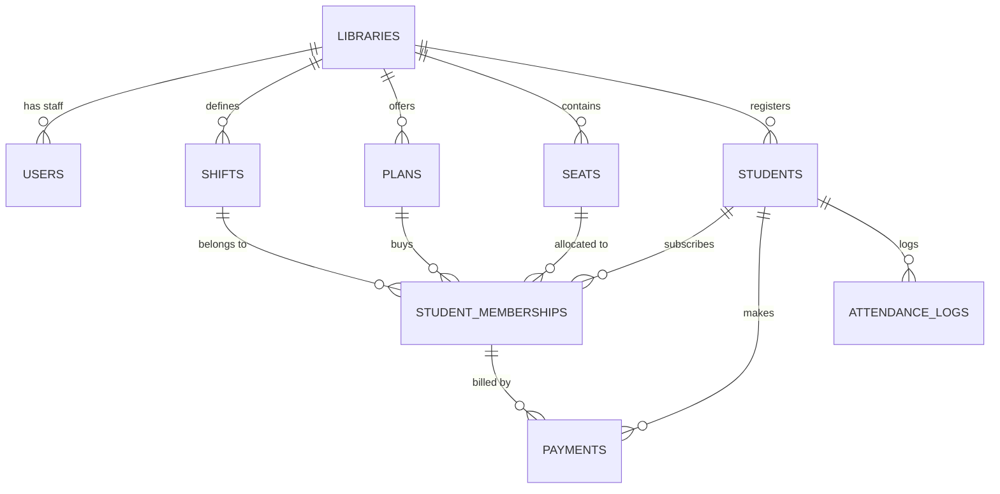

# 🏛️ Complete Backend API Implementation Guide - Laravel
**Project Name:** LibraryManagerPro  
**Architecture Style:** RESTful API  
**Language/Framework:** PHP 8.2+ / Laravel 10.x or 11.x  

---

## 1. 🔍 Deep Research: Modern Library & Study Room Space Management Systems
Globally, modern study halls, libraries, and co-working spaces operate on a **subscription-based space booking model** rather than simple book borrowing. The core operational challenge is **maximizing seat utilization** across different times of the day.

### Key Operational Workflows
1. **Multi-Shift Seat Allocation (Seat Sharing):** Unlike traditional libraries where a seat is assigned permanently, modern libraries use **shift-wise booking**. A single physical seat (e.g., `A-01`) is divided into shifts (e.g., Morning Shift: 6 AM - 12 PM, Evening Shift: 1 PM - 7 PM, Full Day: 6 AM - 10 PM). This allows up to 2-3 different students to share the same physical desk daily, multiplying revenue.
2. **Dynamic Plans & Shifts:** Flexible pricing models based on the combination of **Seat Type** (Regular vs. Premium Cabin) and **Shift Type** (Morning, Afternoon, Evening, Full Day).
3. **Pending Fee Generation & Expiry Alerts:** Automated background cron jobs run daily to mark memberships that have expired, calculate outstanding fees, and notify library owners of pending dues.
4. **Attendance and Access Control:** In real-world systems, barcode scanner or QR code scanning at the entrance records student check-in/out. This prevents unauthorized entry and logs daily attendance.

---

## 2. 🗄️ Database Architecture & ERD Diagram
Below is the database entity relationship design optimized for a shift-based seat allocation model.

### Database Tables:
*   `libraries`: Configures library branches, capacity, address, and contact info.
*   `users`: Stores owners, managers, and receptionists.
*   `shifts`: Standard hours of operations and pricing factors.
*   `plans`: Membership templates (e.g., 1 Month, 3 Months, 1 Year).
*   `seats`: Grid list of physical seats grouped by floor, room, and zone.
*   `students`: Registered students profile information.
*   `student_memberships`: active subscriptions associating a student to a seat, shift, and plan.
*   `payments`: Invoices and transaction history for membership subscriptions and admission fees.
*   `attendance_logs`: Daily check-in and check-out logs.

### Relationship Flow (Mermaid Diagram)


---

## 3. 🛠️ Laravel Database Migrations

Copy these files into your Laravel project's `database/migrations` directory.

### Migration 1: Libraries Table
```php
<?php

use Illuminate\Database\Migrations\Migration;
use Illuminate\Database\Schema\Blueprint;
use Illuminate\Support\Facades\Schema;

return new class extends Migration {
    public function up(): void
    {
        Schema::create('libraries', function (Blueprint $table) {
            $table->id();
            $table->string('name');
            $table->string('owner_name');
            $table->string('email')->nullable();
            $table->string('phone');
            $table->text('address')->nullable();
            $table->integer('capacity')->default(100);
            $table->string('logo_url')->nullable();
            $table->timestamps();
        });
    }

    public function down(): void
    {
        Schema::dropIfExists('libraries');
    }
};
```

### Migration 2: Users Table
```php
<?php

use Illuminate\Database\Migrations\Migration;
use Illuminate\Database\Schema\Blueprint;
use Illuminate\Support\Facades\Schema;

return new class extends Migration {
    public function up(): void
    {
        Schema::create('users', function (Blueprint $table) {
            $table->id();
            $table->foreignId('library_id')->nullable()->constrained('libraries')->onDelete('cascade');
            $table->string('name');
            $table->string('email')->unique();
            $table->string('phone')->unique();
            $table->string('password');
            $table->enum('role', ['owner', 'manager', 'receptionist'])->default('owner');
            $table->rememberToken();
            $table->timestamps();
        });
    }

    public function down(): void
    {
        Schema::dropIfExists('users');
    }
};
```

### Migration 3: Shifts Table
```php
<?php

use Illuminate\Database\Migrations\Migration;
use Illuminate\Database\Schema\Blueprint;
use Illuminate\Support\Facades\Schema;

return new class extends Migration {
    public function up(): void
    {
        Schema::create('shifts', function (Blueprint $table) {
            $table->id();
            $table->foreignId('library_id')->constrained('libraries')->onDelete('cascade');
            $table->string('name'); // e.g., Morning, Afternoon, Evening, Full Day
            $table->string('key_name'); // e.g., morning, afternoon, evening, fullDay
            $table->time('start_time');
            $table->time('end_time');
            $table->string('icon')->default('light_mode');
            $table->timestamps();
        });
    }

    public function down(): void
    {
        Schema::dropIfExists('shifts');
    }
};
```

### Migration 4: Plans Table
```php
<?php

use Illuminate\Database\Migrations\Migration;
use Illuminate\Database\Schema\Blueprint;
use Illuminate\Support\Facades\Schema;

return new class extends Migration {
    public function up(): void
    {
        Schema::create('plans', function (Blueprint $table) {
            $table->id();
            $table->foreignId('library_id')->constrained('libraries')->onDelete('cascade');
            $table->string('name'); // Platinum Plan, Standard Plan, Basic Plan
            $table->integer('duration_months')->default(1);
            $table->decimal('price', 10, 2);
            $table->text('description')->nullable();
            $table->timestamps();
        });
    }

    public function down(): void
    {
        Schema::dropIfExists('plans');
    }
};
```

### Migration 5: Seats Table
```php
<?php

use Illuminate\Database\Migrations\Migration;
use Illuminate\Database\Schema\Blueprint;
use Illuminate\Support\Facades\Schema;

return new class extends Migration {
    public function up(): void
    {
        Schema::create('seats', function (Blueprint $table) {
            $table->id();
            $table->foreignId('library_id')->constrained('libraries')->onDelete('cascade');
            $table->string('seat_number'); // e.g., A-01, B-05, W-1
            $table->string('zone'); // A, B, C
            $table->integer('row');
            $table->integer('col');
            $table->string('floor'); // Ground Floor, 1st Floor, 2nd Floor
            $table->string('room'); // Room A-1, Room A-2, Quiet Zone
            $table->boolean('is_premium')->default(false);
            $table->enum('status', ['available', 'occupied', 'reserved', 'blocked'])->default('available');
            $table->timestamps();
        });
    }

    public function down(): void
    {
        Schema::dropIfExists('seats');
    }
};
```

### Migration 6: Students Table
```php
<?php

use Illuminate\Database\Migrations\Migration;
use Illuminate\Database\Schema\Blueprint;
use Illuminate\Support\Facades\Schema;

return new class extends Migration {
    public function up(): void
    {
        Schema::create('students', function (Blueprint $table) {
            $table->id();
            $table->foreignId('library_id')->constrained('libraries')->onDelete('cascade');
            $table->string('name');
            $table->string('phone');
            $table->string('parent_phone')->nullable();
            $table->string('email')->nullable();
            $table->string('gender')->default('Male');
            $table->date('dob')->nullable();
            $table->string('exam_prep')->nullable(); // UPSC, SSC, Banking, etc.
            $table->string('college')->nullable();
            $table->string('course')->nullable();
            $table->string('photo_url')->nullable();
            $table->string('id_proof_url')->nullable();
            $table->boolean('is_active')->default(true);
            $table->timestamps();
        });
    }

    public function down(): void
    {
        Schema::dropIfExists('students');
    }
};
```

### Migration 7: Student Memberships Table
```php
<?php

use Illuminate\Database\Migrations\Migration;
use Illuminate\Database\Schema\Blueprint;
use Illuminate\Support\Facades\Schema;

return new class extends Migration {
    public function up(): void
    {
        Schema::create('student_memberships', function (Blueprint $table) {
            $table->id();
            $table->foreignId('student_id')->constrained('students')->onDelete('cascade');
            $table->foreignId('seat_id')->nullable()->constrained('seats')->onDelete('set null');
            $table->foreignId('shift_id')->constrained('shifts')->onDelete('restrict');
            $table->foreignId('plan_id')->constrained('plans')->onDelete('restrict');
            $table->string('membership_number')->unique(); // e.g., L-2024-128
            $table->date('start_date');
            $table->date('end_date');
            $table->decimal('price', 10, 2);
            $table->enum('status', ['CURRENT', 'COMPLETED', 'EXPIRED', 'CANCELLED'])->default('CURRENT');
            $table->timestamps();
        });
    }

    public function down(): void
    {
        Schema::dropIfExists('student_memberships');
    }
};
```

### Migration 8: Payments Table
```php
<?php

use Illuminate\Database\Migrations\Migration;
use Illuminate\Database\Schema\Blueprint;
use Illuminate\Support\Facades\Schema;

return new class extends Migration {
    public function up(): void
    {
        Schema::create('payments', function (Blueprint $table) {
            $table->id();
            $table->foreignId('student_id')->constrained('students')->onDelete('cascade');
            $table->foreignId('student_membership_id')->nullable()->constrained('student_memberships')->onDelete('set null');
            $table->decimal('amount', 10, 2);
            $table->decimal('admission_fee', 10, 2)->default(0);
            $table->decimal('security_deposit', 10, 2)->default(0);
            $table->string('payment_method'); // upi, cash, bank
            $table->string('transaction_id')->nullable();
            $table->date('payment_date');
            $table->string('receipt_number')->unique();
            $table->text('note')->nullable();
            $table->enum('status', ['PAID', 'PENDING', 'FAILED'])->default('PAID');
            $table->timestamps();
        });
    }

    public function down(): void
    {
        Schema::dropIfExists('payments');
    }
};
```

### Migration 9: Attendance Logs Table
```php
<?php

use Illuminate\Database\Migrations\Migration;
use Illuminate\Database\Schema\Blueprint;
use Illuminate\Support\Facades\Schema;

return new class extends Migration {
    public function up(): void
    {
        Schema::create('attendance_logs', function (Blueprint $table) {
            $table->id();
            $table->foreignId('student_id')->constrained('students')->onDelete('cascade');
            $table->foreignId('seat_id')->nullable()->constrained('seats')->onDelete('set null');
            $table->date('date');
            $table->time('check_in');
            $table->time('check_out')->nullable();
            $table->timestamps();
        });
    }

    public function down(): void
    {
        Schema::dropIfExists('attendance_logs');
    }
};
```

---

## 4. 🗂️ Laravel Eloquent Models & Relationships

Create these files in `app/Models/`.

### Library.php
```php
<?php

namespace App\Models;

use Illuminate\Database\Eloquent\Model;
use Illuminate\Database\Eloquent\Relations\HasMany;

class Library extends Model
{
    protected $fillable = ['name', 'owner_name', 'email', 'phone', 'address', 'capacity', 'logo_url'];

    public function users(): HasMany { return $this->hasMany(User::class); }
    public function shifts(): HasMany { return $this->hasMany(Shift::class); }
    public function plans(): HasMany { return $this->hasMany(Plan::class); }
    public function seats(): HasMany { return $this->hasMany(Seat::class); }
    public function students(): HasMany { return $this->hasMany(Student::class); }
}
```

### User.php
```php
<?php

namespace App\Models;

use Illuminate\Database\Eloquent\Factories\HasFactory;
use Illuminate\Foundation\Auth\User as Authenticatable;
use Laravel\Sanctum\HasApiTokens;
use Illuminate\Database\Eloquent\Relations\BelongsTo;

class User extends Authenticatable
{
    use HasApiTokens, HasFactory;

    protected $fillable = ['library_id', 'name', 'email', 'phone', 'password', 'role'];
    protected $hidden = ['password', 'remember_token'];

    public function library(): BelongsTo { return $this->belongsTo(Library::class); }
}
```

### Shift.php
```php
<?php

namespace App\Models;

use Illuminate\Database\Eloquent\Model;
use Illuminate\Database\Eloquent\Relations\BelongsTo;

class Shift extends Model
{
    protected $fillable = ['library_id', 'name', 'key_name', 'start_time', 'end_time', 'icon'];

    public function library(): BelongsTo { return $this->belongsTo(Library::class); }
}
```

### Plan.php
```php
<?php

namespace App\Models;

use Illuminate\Database\Eloquent\Model;
use Illuminate\Database\Eloquent\Relations\BelongsTo;

class Plan extends Model
{
    protected $fillable = ['library_id', 'name', 'duration_months', 'price', 'description'];

    public function library(): BelongsTo { return $this->belongsTo(Library::class); }
}
```

### Seat.php
```php
<?php

namespace App\Models;

use Illuminate\Database\Eloquent\Model;
use Illuminate\Database\Eloquent\Relations\BelongsTo;
use Illuminate\Database\Eloquent\Relations\HasMany;

class Seat extends Model
{
    protected $fillable = [
        'library_id', 'seat_number', 'zone', 'row', 'col',
        'floor', 'room', 'is_premium', 'status'
    ];

    public function library(): BelongsTo { return $this->belongsTo(Library::class); }
    public function memberships(): HasMany { return $this->hasMany(StudentMembership::class); }
}
```

### Student.php
```php
<?php

namespace App\Models;

use Illuminate\Database\Eloquent\Model;
use Illuminate\Database\Eloquent\Relations\BelongsTo;
use Illuminate\Database\Eloquent\Relations\HasMany;
use Illuminate\Database\Eloquent\Relations\HasOne;

class Student extends Model
{
    protected $fillable = [
        'library_id', 'name', 'phone', 'parent_phone', 'email', 'gender',
        'dob', 'exam_prep', 'college', 'course', 'photo_url', 'id_proof_url', 'is_active'
    ];

    public function library(): BelongsTo { return $this->belongsTo(Library::class); }
    public function memberships(): HasMany { return $this->hasMany(StudentMembership::class); }
    
    public function activeMembership(): HasOne
    {
        return $this->hasOne(StudentMembership::class)->where('status', 'CURRENT');
    }
    
    public function payments(): HasMany { return $this->hasMany(Payment::class); }
    public function attendanceLogs(): HasMany { return $this->hasMany(AttendanceLog::class); }
}
```

### StudentMembership.php
```php
<?php

namespace App\Models;

use Illuminate\Database\Eloquent\Model;
use Illuminate\Database\Eloquent\Relations\BelongsTo;
use Illuminate\Database\Eloquent\Relations\HasMany;

class StudentMembership extends Model
{
    protected $fillable = [
        'student_id', 'seat_id', 'shift_id', 'plan_id',
        'membership_number', 'start_date', 'end_date', 'price', 'status'
    ];

    public function student(): BelongsTo { return $this->belongsTo(Student::class); }
    public function seat(): BelongsTo { return $this->belongsTo(Seat::class); }
    public function shift(): BelongsTo { return $this->belongsTo(Shift::class); }
    public function plan(): BelongsTo { return $this->belongsTo(Plan::class); }
    public function payments(): HasMany { return $this->hasMany(Payment::class); }
}
```

### Payment.php
```php
<?php

namespace App\Models;

use Illuminate\Database\Eloquent\Model;
use Illuminate\Database\Eloquent\Relations\BelongsTo;

class Payment extends Model
{
    protected $fillable = [
        'student_id', 'student_membership_id', 'amount', 'admission_fee',
        'security_deposit', 'payment_method', 'transaction_id', 'payment_date',
        'receipt_number', 'note', 'status'
    ];

    public function student(): BelongsTo { return $this->belongsTo(Student::class); }
    public function membership(): BelongsTo { return $this->belongsTo(StudentMembership::class, 'student_membership_id'); }
}
```

### AttendanceLog.php
```php
<?php

namespace App\Models;

use Illuminate\Database\Eloquent\Model;
use Illuminate\Database\Eloquent\Relations\BelongsTo;

class AttendanceLog extends Model
{
    protected $fillable = ['student_id', 'seat_id', 'date', 'check_in', 'check_out'];

    public function student(): BelongsTo { return $this->belongsTo(Student::class); }
    public function seat(): BelongsTo { return $this->belongsTo(Seat::class); }
}
```

---

## 5. 🛣️ Laravel API Routing (`routes/api.php`)

```php
<?php

use Illuminate\Support\Facades\Route;
use App\Http\Controllers\Api\AuthController;
use App\Http\Controllers\Api\DashboardController;
use App\Http\Controllers\Api\StudentController;
use App\Http\Controllers\Api\SeatController;
use App\Http\Controllers\Api\FeeController;
use App\Http\Controllers\Api\ConfigController;

/*
|--------------------------------------------------------------------------
| API Routes
|--------------------------------------------------------------------------
*/

// Public Routes
Route::post('/auth/login', [AuthController::class, 'login']);

// Authenticated Routes
Route::middleware('auth:sanctum')->group(function () {
    
    // Auth & Profile
    Route::post('/auth/logout', [AuthController::class, 'logout']);
    Route::get('/auth/me', [AuthController::class, 'me']);
    
    // Dashboard Stats
    Route::get('/dashboard/stats', [DashboardController::class, 'getStats']);
    Route::get('/dashboard/greeting', [DashboardController::class, 'getGreeting']);
    
    // Student Management
    Route::apiResource('students', StudentController::class);
    Route::get('/students/{student}/memberships', [StudentController::class, 'membershipHistory']);
    
    // Seating Management
    Route::get('/seats/layout', [SeatController::class, 'getLayout']);
    Route::get('/seats/floors', [SeatController::class, 'getFloors']);
    Route::post('/seats/allocate', [SeatController::class, 'allocateSeat']);
    Route::post('/seats/release', [SeatController::class, 'releaseSeat']);
    
    // Fees & Transactions
    Route::get('/fees/outstanding', [FeeController::class, 'getOutstanding']);
    Route::get('/fees/stats', [FeeController::class, 'getFeeStats']);
    Route::post('/fees/pay', [FeeController::class, 'collectPayment']);
    Route::get('/fees/payments', [FeeController::class, 'paymentHistory']);
    Route::get('/fees/receipt/{payment}', [FeeController::class, 'getReceipt']);
    
    // Dynamic Configuration CRUD (Settings, Staff, Shifts, Plans)
    Route::get('/config/shifts', [ConfigController::class, 'getShifts']);
    Route::post('/config/shifts', [ConfigController::class, 'saveShift']);
    Route::get('/config/plans', [ConfigController::class, 'getPlans']);
    Route::post('/config/plans', [ConfigController::class, 'savePlan']);
    Route::put('/config/library-profile', [ConfigController::class, 'updateLibraryProfile']);
    
    // Manage Staff (Admins/Managers)
    Route::get('/staff', [ConfigController::class, 'listStaff']);
    Route::post('/staff', [ConfigController::class, 'addStaff']);
    Route::delete('/staff/{user}', [ConfigController::class, 'removeStaff']);
});
```

---

## 6. 🎮 Laravel Controllers

Create these controllers in `app/Http/Controllers/Api/`.

### AuthController.php
```php
<?php

namespace App\Http\Controllers\Api;

use App\Http\Controllers\Controller;
use Illuminate\Http\Request;
use App\Models\User;
use Illuminate\Support\Facades\Hash;
use Illuminate\Validation\ValidationException;

class AuthController extends Controller
{
    public function login(Request $request)
    {
        $request->validate([
            'phone' => 'required|string',
            'password' => 'required|string|min:4',
        ]);

        // Find user by phone (allowing raw formatting support)
        $phone = preg_replace('/[^0-9]/', '', $request->phone);
        $user = User::with('library')->whereRaw("REGEXP_REPLACE(phone, '[^0-9]', '') LIKE ?", ["%$phone%"])->first();

        if (!$user || !Hash::check($request->password, $user->password)) {
            return response()->json([
                'status' => 'error',
                'message' => 'Invalid mobile number or password.'
            ], 401);
        }

        $token = $user->createToken('auth_token')->plainTextToken;

        return response()->json([
            'status' => 'success',
            'message' => 'Logged in successfully',
            'data' => [
                'token' => $token,
                'user' => [
                    'id' => $user->id,
                    'name' => $user->name,
                    'email' => $user->email,
                    'phone' => $user->phone,
                    'role' => $user->role,
                    'library_name' => $user->library ? $user->library->name : 'N/A',
                ]
            ]
        ]);
    }

    public function logout(Request $request)
    {
        $request->user()->currentAccessToken()->delete();
        return response()->json([
            'status' => 'success',
            'message' => 'Logged out successfully'
        ]);
    }

    public function me(Request $request)
    {
        $user = $request->user()->load('library');
        return response()->json([
            'status' => 'success',
            'data' => $user
        ]);
    }
}
```

### DashboardController.php
```php
<?php

namespace App\Http\Controllers\Api;

use App\Http\Controllers\Controller;
use Illuminate\Http\Request;
use App\Models\Student;
use App\Models\Seat;
use App\Models\Payment;
use App\Models\StudentMembership;
use Carbon\Carbon;

class DashboardController extends Controller
{
    public function getGreeting(Request $request)
    {
        $hour = now()->hour;
        $greeting = 'Good Evening';
        if ($hour < 12) $greeting = 'Good Morning';
        elseif ($hour < 17) $greeting = 'Good Afternoon';

        return response()->json([
            'status' => 'success',
            'data' => [
                'greeting' => $greeting,
                'dateLine' => now()->format('l, F d, Y'),
                'welcomeLine' => 'Welcome back, ' . $request->user()->name
            ]
        ]);
    }

    public function getStats(Request $request)
    {
        $libraryId = $request->user()->library_id;

        // KPI Counts
        $totalStudents = Student::where('library_id', $libraryId)->count();
        $occupiedSeats = Seat::where('library_id', $libraryId)->where('status', 'occupied')->count();
        $vacantSeats = Seat::where('library_id', $libraryId)->where('status', 'available')->count();
        
        // Expiry calculations (expiring in next 7 days)
        $expiringSoon = StudentMembership::whereHas('student', function($q) use ($libraryId) {
            $q->where('library_id', $libraryId);
        })
        ->where('status', 'CURRENT')
        ->whereBetween('end_date', [now(), now()->addDays(7)])
        ->count();

        // Revenue calculations
        $startOfMonth = Carbon::now()->startOfMonth();
        $endOfMonth = Carbon::now()->endOfMonth();
        
        $monthlyRevenue = Payment::whereHas('student', function($q) use ($libraryId) {
            $q->where('library_id', $libraryId);
        })
        ->whereBetween('payment_date', [$startOfMonth, $endOfMonth])
        ->where('status', 'PAID')
        ->sum('amount');

        // Total Pending outstanding payments
        $pendingFees = Payment::whereHas('student', function($q) use ($libraryId) {
            $q->where('library_id', $libraryId);
        })
        ->where('status', 'PENDING')
        ->sum('amount');

        return response()->json([
            'status' => 'success',
            'data' => [
                [
                    'id' => 'totalStudents',
                    'label' => 'Total Students',
                    'value' => $totalStudents,
                    'icon' => 'group',
                    'accent' => 'PRIMARY',
                    'screen' => 'Students'
                ],
                [
                    'id' => 'occupiedSeats',
                    'label' => 'Occupied Seats',
                    'value' => $occupiedSeats,
                    'icon' => 'event_seat',
                    'accent' => 'SECONDARY',
                    'screen' => 'Seats'
                ],
                [
                    'id' => 'monthlyRevenue',
                    'label' => 'Monthly Revenue',
                    'value' => '₹' . number_format($monthlyRevenue),
                    'icon' => 'payments',
                    'accent' => 'TERTIARY_CONTAINER',
                    'screen' => 'Fees'
                ],
                [
                    'id' => 'pendingFees',
                    'label' => 'Pending Fees',
                    'value' => '₹' . number_format($pendingFees),
                    'icon' => 'warning',
                    'accent' => 'ERROR',
                    'screen' => 'Fees'
                ],
                [
                    'id' => 'expiringSoon',
                    'label' => 'Expiring Soon',
                    'value' => $expiringSoon,
                    'icon' => 'calendar_clock',
                    'accent' => 'TERTIARY',
                    'screen' => 'Students'
                ],
                [
                    'id' => 'vacantSeats',
                    'label' => 'Vacant Seats',
                    'value' => $vacantSeats,
                    'icon' => 'door_open',
                    'accent' => 'OUTLINE',
                    'screen' => 'Seats'
                ]
            ]
        ]);
    }
}
```

### StudentController.php
```php
<?php

namespace App\Http\Controllers\Api;

use App\Http\Controllers\Controller;
use Illuminate\Http\Request;
use App\Models\Student;
use App\Models\StudentMembership;
use App\Models\Seat;
use App\Models\Shift;
use App\Models\Plan;
use App\Models\Payment;
use Illuminate\Support\Facades\DB;
use Illuminate\Support\Facades\Storage;

class StudentController extends Controller
{
    public function index(Request $request)
    {
        $libraryId = $request->user()->library_id;
        $search = $request->query('search');
        $filter = $request->query('filter'); // active, pending, expired, new

        $query = Student::where('library_id', $libraryId)->with(['activeMembership.seat', 'activeMembership.shift']);

        if ($search) {
            $query->where(function($q) use ($search) {
                $q->where('name', 'like', "%$search%")
                  ->orWhere('phone', 'like', "%$search%");
            });
        }

        if ($filter) {
            if ($filter === 'active') {
                $query->whereHas('activeMembership', function($q) {
                    $q->where('end_date', '>=', now());
                });
            } elseif ($filter === 'pending') {
                $query->whereHas('payments', function($q) {
                    $q->where('status', 'PENDING');
                });
            } elseif ($filter === 'expired') {
                $query->whereDoesntHave('activeMembership')
                      ->orWhereHas('memberships', function($q) {
                          $q->where('end_date', '<', now());
                      });
            } elseif ($filter === 'new') {
                $query->where('created_at', '>=', now()->subDays(7));
            }
        }

        $students = $query->latest()->get();

        // Map response to match React Native app format
        $mapped = $students->map(function ($s) {
            $initials = collect(explode(' ', $s->name))->map(fn($n) => mb_substr($n, 0, 1))->join('');
            
            $activeMember = $s->activeMembership;
            $hasPending = $s->payments()->where('status', 'PENDING')->sum('amount');
            
            return [
                'id' => 'st_' . $s->id,
                'name' => $s->name,
                'phone' => $s->phone,
                'initials' => strtoupper(substr($initials, 0, 2)),
                'avatarColor' => $s->gender === 'Female' ? '#FFDBCD' : '#DBE1FF',
                'status' => $hasPending > 0 ? 'PENDING' : ($activeMember ? 'PAID' : 'EXPIRED'),
                'seat' => $activeMember && $activeMember->seat ? $activeMember->seat->seat_number : 'None',
                'membershipId' => $activeMember ? $activeMember->membership_number : 'N/A',
                'plan' => $activeMember ? [
                    'name' => $activeMember->plan->name,
                    'shift' => $activeMember->shift->name,
                    'price' => $activeMember->price
                ] : null,
                'period' => $activeMember ? [
                    'from' => \Carbon\Carbon::parse($activeMember->start_date)->format('M d, Y'),
                    'to' => \Carbon\Carbon::parse($activeMember->end_date)->format('M d, Y')
                ] : null,
                'active' => $s->is_active && $activeMember ? true : false,
                'pendingAmount' => (int)$hasPending
            ];
        });

        return response()->json([
            'status' => 'success',
            'data' => $mapped
        ]);
    }

    public function show(Request $request, $id)
    {
        // Strip prefix if any
        $id = str_replace('st_', '', $id);
        $student = Student::where('library_id', $request->user()->library_id)
            ->with(['memberships.seat', 'memberships.shift', 'memberships.plan', 'payments'])
            ->findOrFail($id);

        return response()->json([
            'status' => 'success',
            'data' => $student
        ]);
    }

    public function store(Request $request)
    {
        $request->validate([
            'name' => 'required|string',
            'phone' => 'required|string',
            'parentPhone' => 'required|string',
            'email' => 'nullable|email',
            'gender' => 'required|string',
            'dob' => 'nullable|date',
            'exam' => 'nullable|string',
            'college' => 'nullable|string',
            'course' => 'nullable|string',
            'floor' => 'required|string',
            'room' => 'required|string',
            'shift' => 'required|string', // morning, afternoon, evening, fullDay
            'admissionFee' => 'nullable|numeric',
            'monthlyFee' => 'required|numeric',
            'securityDeposit' => 'nullable|numeric',
            'photo' => 'nullable|image|max:2048',
            'idProof' => 'nullable|file|mimes:pdf,jpg,jpeg,png|max:5120',
        ]);

        $libraryId = $request->user()->library_id;

        DB::beginTransaction();
        try {
            // Upload Photo
            $photoPath = null;
            if ($request->hasFile('photo')) {
                $photoPath = $request->file('photo')->store('students/photos', 'public');
            }

            // Upload ID Proof
            $idProofPath = null;
            if ($request->hasFile('idProof')) {
                $idProofPath = $request->file('idProof')->store('students/ids', 'public');
            }

            // 1. Create Student
            $student = Student::create([
                'library_id' => $libraryId,
                'name' => $request->name,
                'phone' => $request->phone,
                'parent_phone' => $request->parentPhone,
                'email' => $request->email,
                'gender' => $request->gender,
                'dob' => $request->dob,
                'exam_prep' => $request->exam,
                'college' => $request->college,
                'course' => $request->course,
                'photo_url' => $photoPath ? Storage::url($photoPath) : null,
                'id_proof_url' => $idProofPath ? Storage::url($idProofPath) : null,
                'is_active' => true,
            ]);

            // 2. Fetch configured shift and dummy/selected seat
            $shift = Shift::where('library_id', $libraryId)->where('key_name', $request->shift)->firstOrFail();
            
            // Auto allocate next available seat on floor/room if map wasn't specifically used
            $seat = Seat::where('library_id', $libraryId)
                ->where('floor', $request->floor)
                ->where('room', $request->room)
                ->where('status', 'available')
                ->first();
                
            if (!$seat) {
                // Failback to any seat
                $seat = Seat::where('library_id', $libraryId)->where('status', 'available')->first();
            }

            if ($seat) {
                $seat->update(['status' => 'occupied']);
            }

            // Create Plan dynamic reference or look up
            $plan = Plan::where('library_id', $libraryId)
                ->where('price', '<=', $request->monthlyFee)
                ->first();
            
            if (!$plan) {
                $plan = Plan::create([
                    'library_id' => $libraryId,
                    'name' => 'Custom Shift Plan',
                    'duration_months' => 1,
                    'price' => $request->monthlyFee
                ]);
            }

            // 3. Create Student Membership
            $membershipNo = 'L-' . now()->year . '-' . rand(100, 999);
            $membership = StudentMembership::create([
                'student_id' => $student->id,
                'seat_id' => $seat ? $seat->id : null,
                'shift_id' => $shift->id,
                'plan_id' => $plan->id,
                'membership_number' => $membershipNo,
                'start_date' => now(),
                'end_date' => now()->addMonth(),
                'price' => $request->monthlyFee,
                'status' => 'CURRENT'
            ]);

            // 4. Create Initial Payments (Admission + Security + Monthly)
            $totalAmount = $request->monthlyFee + ($request->admissionFee ?? 0) + ($request->securityDeposit ?? 0);
            
            Payment::create([
                'student_id' => $student->id,
                'student_membership_id' => $membership->id,
                'amount' => $totalAmount,
                'admission_fee' => $request->admissionFee ?? 0,
                'security_deposit' => $request->securityDeposit ?? 0,
                'payment_method' => 'cash', // Default startup
                'payment_date' => now(),
                'receipt_number' => 'REC-' . time() . rand(10, 99),
                'status' => 'PAID'
            ]);

            DB::commit();

            return response()->json([
                'status' => 'success',
                'message' => 'Student registered successfully',
                'data' => $student
            ], 201);

        } catch (\Exception $e) {
            DB::rollBack();
            return response()->json([
                'status' => 'error',
                'message' => 'Failed to create student: ' . $e->getMessage()
            ], 500);
        }
    }

    public function update(Request $request, $id)
    {
        $id = str_replace('st_', '', $id);
        $student = Student::findOrFail($id);

        $student->update($request->all());

        return response()->json([
            'status' => 'success',
            'message' => 'Student details updated successfully',
            'data' => $student
        ]);
    }

    public function destroy(Request $request, $id)
    {
        $id = str_replace('st_', '', $id);
        $student = Student::findOrFail($id);
        
        // Release seat if occupied
        $membership = $student->activeMembership;
        if ($membership && $membership->seat) {
            $membership->seat->update(['status' => 'available']);
        }

        $student->delete();

        return response()->json([
            'status' => 'success',
            'message' => 'Student archived successfully'
        ]);
    }

    public function membershipHistory(Request $request, $id)
    {
        $id = str_replace('st_', '', $id);
        $memberships = StudentMembership::where('student_id', $id)
            ->with(['seat', 'shift', 'plan'])
            ->latest()
            ->get();

        return response()->json([
            'status' => 'success',
            'data' => $memberships
        ]);
    }
}
```

### SeatController.php
```php
<?php

namespace App\Http\Controllers\Api;

use App\Http\Controllers\Controller;
use Illuminate\Http\Request;
use App\Models\Seat;
use App\Models\StudentMembership;
use App\Models\Student;

class SeatController extends Controller
{
    public function getFloors(Request $request)
    {
        $libraryId = $request->user()->library_id;
        $floors = Seat::where('library_id', $libraryId)
            ->select('floor')
            ->distinct()
            ->get()
            ->pluck('floor');

        // Map to format
        $mapped = $floors->map(function ($floor, $index) use ($libraryId) {
            $capacity = Seat::where('library_id', $libraryId)->where('floor', $floor)->count();
            return [
                'id' => 'f' . ($index + 1),
                'label' => $floor,
                'capacity' => $capacity
            ];
        });

        return response()->json([
            'status' => 'success',
            'data' => $mapped
        ]);
    }

    public function getLayout(Request $request)
    {
        $libraryId = $request->user()->library_id;
        $floorName = $request->query('floor', 'Floor 1 - Main Hall');

        $seats = Seat::where('library_id', $libraryId)
            ->where('floor', $floorName)
            ->get();

        // Convert into mapped array matching app structure
        $mapped = $seats->map(function ($s) {
            return [
                'id' => $s->seat_number,
                'row' => $s->row,
                'col' => $s->col,
                'zone' => $s->zone,
                'status' => $s->status,
                'premium' => $s->is_premium ? true : false
            ];
        });

        return response()->json([
            'status' => 'success',
            'data' => $mapped
        ]);
    }

    public function allocateSeat(Request $request)
    {
        $request->validate([
            'student_id' => 'required',
            'seat_number' => 'required|string',
            'shift_key' => 'required|string'
        ]);

        $libraryId = $request->user()->library_id;
        $studentId = str_replace('st_', '', $request->student_id);

        $seat = Seat::where('library_id', $libraryId)->where('seat_number', $request->seat_number)->firstOrFail();
        
        if ($seat->status === 'occupied') {
            return response()->json(['status' => 'error', 'message' => 'Seat already occupied'], 400);
        }

        $student = Student::findOrFail($studentId);
        $membership = $student->activeMembership;

        if (!$membership) {
            return response()->json(['status' => 'error', 'message' => 'Student does not have active membership plan.'], 400);
        }

        // Release old seat if allocated
        if ($membership->seat_id) {
            $oldSeat = Seat::find($membership->seat_id);
            if ($oldSeat) $oldSeat->update(['status' => 'available']);
        }

        // Allocate seat
        $membership->update(['seat_id' => $seat->id]);
        $seat->update(['status' => 'occupied']);

        return response()->json([
            'status' => 'success',
            'message' => "Seat {$seat->seat_number} allocated to student {$student->name}"
        ]);
    }

    public function releaseSeat(Request $request)
    {
        $request->validate([
            'seat_number' => 'required|string'
        ]);

        $libraryId = $request->user()->library_id;
        $seat = Seat::where('library_id', $libraryId)->where('seat_number', $request->seat_number)->firstOrFail();

        $membership = StudentMembership::where('seat_id', $seat->id)->where('status', 'CURRENT')->first();
        if ($membership) {
            $membership->update(['seat_id' => null]);
        }

        $seat->update(['status' => 'available']);

        return response()->json([
            'status' => 'success',
            'message' => "Seat {$seat->seat_number} is now vacant."
        ]);
    }
}
```

### FeeController.php
```php
<?php

namespace App\Http\Controllers\Api;

use App\Http\Controllers\Controller;
use Illuminate\Http\Request;
use App\Models\Payment;
use App\Models\Student;
use App\Models\StudentMembership;
use Illuminate\Support\Facades\DB;

class FeeController extends Controller
{
    public function getOutstanding(Request $request)
    {
        $libraryId = $request->user()->library_id;
        
        $pendingPayments = Payment::whereHas('student', function($q) use ($libraryId) {
            $q->where('library_id', $libraryId);
        })
        ->where('status', 'PENDING')
        ->with('student.activeMembership.seat')
        ->get();

        $mapped = $pendingPayments->map(function ($p) {
            $s = $p->student;
            $initials = collect(explode(' ', $s->name))->map(fn($n) => mb_substr($n, 0, 1))->join('');
            
            return [
                'id' => 'os' . $p->id,
                'student_id' => 'st_' . $s->id,
                'name' => $s->name,
                'seat' => $s->activeMembership && $s->activeMembership->seat ? $s->activeMembership->seat->seat_number : 'N/A',
                'amount' => (int)$p->amount,
                'initials' => strtoupper(substr($initials, 0, 2)),
                'avatarColor' => '#DBE1FF'
            ];
        });

        return response()->json([
            'status' => 'success',
            'data' => $mapped
        ]);
    }

    public function collectPayment(Request $request)
    {
        $request->validate([
            'student_id' => 'required',
            'amount' => 'required|numeric',
            'payment_method' => 'required|string', // upi, cash, bank
            'note' => 'nullable|string'
        ]);

        $studentId = str_replace('st_', '', $request->student_id);
        $student = Student::findOrFail($studentId);

        // Find pending payment or create new transactional payment invoice
        $pendingPayment = Payment::where('student_id', $student->id)
            ->where('status', 'PENDING')
            ->first();

        if ($pendingPayment) {
            $pendingPayment->update([
                'amount' => $request->amount,
                'payment_method' => $request->payment_method,
                'payment_date' => now(),
                'transaction_id' => 'TXN-' . time(),
                'note' => $request->note,
                'status' => 'PAID'
            ]);
            $payment = $pendingPayment;
        } else {
            // Register a fresh manual fee collection
            $membership = $student->activeMembership;
            
            $payment = Payment::create([
                'student_id' => $student->id,
                'student_membership_id' => $membership ? $membership->id : null,
                'amount' => $request->amount,
                'payment_method' => $request->payment_method,
                'payment_date' => now(),
                'transaction_id' => 'TXN-' . time(),
                'receipt_number' => 'REC-' . time() . rand(10, 99),
                'note' => $request->note,
                'status' => 'PAID'
            ]);
        }

        return response()->json([
            'status' => 'success',
            'message' => 'Payment collected successfully',
            'data' => [
                'receipt_number' => $payment->receipt_number,
                'payment_date' => $payment->payment_date,
                'amount' => $payment->amount
            ]
        ]);
    }

    public function getReceipt(Request $request, $id)
    {
        // Strip REC if needed
        $payment = Payment::with(['student.activeMembership.seat', 'membership.shift', 'membership.plan'])->findOrFail($id);

        return response()->json([
            'status' => 'success',
            'data' => [
                'receiptNo' => $payment->receipt_number,
                'date' => \Carbon\Carbon::parse($payment->payment_date)->format('M d, Y'),
                'studentName' => $payment->student->name,
                'seatNumber' => $payment->membership && $payment->membership->seat ? $payment->membership->seat->seat_number : 'N/A',
                'planName' => $payment->membership && $payment->membership->plan ? $payment->membership->plan->name : 'Custom Plan',
                'shiftName' => $payment->membership && $payment->membership->shift ? $payment->membership->shift->name : 'N/A',
                'amount' => $payment->amount,
                'admissionFee' => $payment->admission_fee,
                'securityDeposit' => $payment->security_deposit,
                'paymentMethod' => strtoupper($payment->payment_method),
                'transactionId' => $payment->transaction_id ?? 'CASH_TRANS',
            ]
        ]);
    }

    public function getFeeStats(Request $request)
    {
        $libraryId = $request->user()->library_id;
        
        $pendingAmount = Payment::whereHas('student', function($q) use ($libraryId) {
            $q->where('library_id', $libraryId);
        })
        ->where('status', 'PENDING')
        ->sum('amount');

        $unpaidCount = Payment::whereHas('student', function($q) use ($libraryId) {
            $q->where('library_id', $libraryId);
        })
        ->where('status', 'PENDING')
        ->select('student_id')
        ->distinct()
        ->count();

        return response()->json([
            'status' => 'success',
            'data' => [
                'pendingThisMonth' => [
                    'label' => 'Pending This Month',
                    'value' => '₹' . number_format($pendingAmount),
                    'accent' => 'PRIMARY_CONTAINER'
                ],
                'unpaidStudents' => [
                    'label' => 'Unpaid Students',
                    'value' => $unpaidCount,
                    'accent' => 'SECONDARY_CONTAINER'
                ]
            ]
        ]);
    }

    public function paymentHistory(Request $request)
    {
        $libraryId = $request->user()->library_id;
        
        $payments = Payment::whereHas('student', function($q) use ($libraryId) {
            $q->where('library_id', $libraryId);
        })
        ->with('student')
        ->latest()
        ->get();

        return response()->json([
            'status' => 'success',
            'data' => $payments
        ]);
    }
}
```

### ConfigController.php
```php
<?php

namespace App\Http\Controllers\Api;

use App\Http\Controllers\Controller;
use Illuminate\Http\Request;
use App\Models\Shift;
use App\Models\Plan;
use App\Models\Library;
use App\Models\User;
use Illuminate\Support\Facades\Hash;

class ConfigController extends Controller
{
    public function getShifts(Request $request)
    {
        $shifts = Shift::where('library_id', $request->user()->library_id)->get();
        return response()->json(['status' => 'success', 'data' => $shifts]);
    }

    public function getPlans(Request $request)
    {
        $plans = Plan::where('library_id', $request->user()->library_id)->get();
        return response()->json(['status' => 'success', 'data' => $plans]);
    }

    public function updateLibraryProfile(Request $request)
    {
        $request->validate([
            'name' => 'required|string',
            'owner_name' => 'required|string',
            'phone' => 'required|string',
            'address' => 'nullable|string',
        ]);

        $library = Library::findOrFail($request->user()->library_id);
        $library->update($request->all());

        return response()->json([
            'status' => 'success',
            'message' => 'Library profile settings updated successfully',
            'data' => $library
        ]);
    }

    public function listStaff(Request $request)
    {
        $staff = User::where('library_id', $request->user()->library_id)
            ->where('role', '!=', 'owner')
            ->get();
            
        return response()->json(['status' => 'success', 'data' => $staff]);
    }

    public function addStaff(Request $request)
    {
        $request->validate([
            'name' => 'required|string',
            'email' => 'required|email|unique:users',
            'phone' => 'required|unique:users',
            'password' => 'required|min:4',
            'role' => 'required|in:manager,receptionist'
        ]);

        $staff = User::create([
            'library_id' => $request->user()->library_id,
            'name' => $request->name,
            'email' => $request->email,
            'phone' => $request->phone,
            'password' => Hash::make($request->password),
            'role' => $request->role
        ]);

        return response()->json([
            'status' => 'success',
            'message' => 'Staff added successfully',
            'data' => $staff
        ], 201);
    }

    public function removeStaff(Request $request, User $user)
    {
        if ($user->library_id !== $request->user()->library_id) {
            return response()->json(['status' => 'error', 'message' => 'Unauthorized action.'], 403);
        }

        $user->delete();
        return response()->json(['status' => 'success', 'message' => 'Staff member removed.']);
    }
}
```

---

## 7. 🌱 Laravel Seeders Setup
Put this code in your `database/seeders/DatabaseSeeder.php` to populate matching dummy data.

```php
<?php

namespace Database\Seeders;

use Illuminate\Database\Seeder;
use App\Models\Library;
use App\Models\User;
use App\Models\Shift;
use App\Models\Plan;
use App\Models\Seat;
use App\Models\Student;
use App\Models\StudentMembership;
use App\Models\Payment;
use Illuminate\Support\Facades\Hash;

class DatabaseSeeder extends Seeder
{
    public function run(): void
    {
        // 1. Create Core Library
        $library = Library::create([
            'name' => 'Central Library Branch',
            'owner_name' => 'Rahul Sharma',
            'email' => 'rahul@librarymanagerpro.com',
            'phone' => '+91 98765 43210',
            'address' => '42, Vidya Vihar Colony, Near Coaching Hub, Indore, MP',
            'capacity' => 90
        ]);

        // 2. Create Owner User Account
        User::create([
            'library_id' => $library->id,
            'name' => 'Rahul',
            'email' => 'rahul@librarymanagerpro.com',
            'phone' => '9876543210',
            'password' => Hash::make('password123'), // matching demo
            'role' => 'owner'
        ]);

        // 3. Create Standard Operating Shifts
        $shifts = [
            ['name' => 'Morning', 'key_name' => 'morning', 'start_time' => '06:00:00', 'end_time' => '12:00:00', 'icon' => 'light_mode'],
            ['name' => 'Afternoon', 'key_name' => 'afternoon', 'start_time' => '12:00:00', 'end_time' => '17:00:00', 'icon' => 'sunny'],
            ['name' => 'Evening', 'key_name' => 'evening', 'start_time' => '17:00:00', 'end_time' => '22:00:00', 'icon' => 'dark_mode'],
            ['name' => 'Full Day', 'key_name' => 'fullDay', 'start_time' => '06:00:00', 'end_time' => '22:00:00', 'icon' => 'history'],
        ];
        
        foreach ($shifts as $s) {
            Shift::create(array_merge($s, ['library_id' => $library->id]));
        }

        // 4. Create Standard Membership Plans
        $plans = [
            ['name' => 'Basic Plan', 'duration_months' => 1, 'price' => 1000.00, 'description' => 'Single Shift Study Desk Access'],
            ['name' => 'Standard Plan', 'duration_months' => 1, 'price' => 1500.00, 'description' => 'Two Shifts Study Desk Access'],
            ['name' => 'Platinum Plan', 'duration_months' => 1, 'price' => 2500.00, 'description' => 'Full Day Premium Cabin Access'],
        ];

        foreach ($plans as $p) {
            Plan::create(array_merge($p, ['library_id' => $library->id]));
        }

        // 5. Seed Seats Grid Layout
        $floors = ['Ground Floor', '1st Floor', '2nd Floor'];
        $rooms = ['Room A-1', 'Room A-2', 'Quiet Zone'];
        
        // Create 20 seats for mockup demo mapping
        $seatNumbers = [
            ['num' => 'A-01', 'zone' => 'A', 'row' => 0, 'col' => 0, 'premium' => false, 'status' => 'available'],
            ['num' => 'A-02', 'zone' => 'A', 'row' => 0, 'col' => 1, 'premium' => false, 'status' => 'available'],
            ['num' => 'A-03', 'zone' => 'A', 'row' => 0, 'col' => 2, 'premium' => false, 'status' => 'occupied'],
            ['num' => 'A-04', 'zone' => 'A', 'row' => 0, 'col' => 3, 'premium' => false, 'status' => 'available'],
            ['num' => 'A-05', 'zone' => 'A', 'row' => 1, 'col' => 0, 'premium' => false, 'status' => 'occupied'],
            ['num' => 'A-06', 'zone' => 'A', 'row' => 1, 'col' => 1, 'premium' => false, 'status' => 'available'],
            ['num' => 'A-07', 'zone' => 'A', 'row' => 1, 'col' => 2, 'premium' => false, 'status' => 'reserved'],
            ['num' => 'A-08', 'zone' => 'A', 'row' => 1, 'col' => 3, 'premium' => false, 'status' => 'available'],
            ['num' => 'A-12', 'zone' => 'A', 'row' => 2, 'col' => 3, 'premium' => false, 'status' => 'blocked'],
            ['num' => 'B-01', 'zone' => 'B', 'row' => 0, 'col' => 0, 'premium' => false, 'status' => 'available'],
            ['num' => 'B-02', 'zone' => 'B', 'row' => 0, 'col' => 1, 'premium' => false, 'status' => 'occupied'],
            ['num' => 'B-03', 'zone' => 'B', 'row' => 0, 'col' => 2, 'premium' => false, 'status' => 'available'],
            ['num' => 'W-1', 'zone' => 'C', 'row' => 0, 'col' => 0, 'premium' => true, 'status' => 'reserved'],
            ['num' => 'W-2', 'zone' => 'C', 'row' => 0, 'col' => 1, 'premium' => true, 'status' => 'available'],
            ['num' => 'W-4', 'zone' => 'C', 'row' => 0, 'col' => 3, 'premium' => true, 'status' => 'occupied'],
        ];

        foreach ($seatNumbers as $sData) {
            Seat::create([
                'library_id' => $library->id,
                'seat_number' => $sData['num'],
                'zone' => $sData['zone'],
                'row' => $sData['row'],
                'col' => $sData['col'],
                'floor' => 'Ground Floor',
                'room' => 'Room A-1',
                'is_premium' => $sData['premium'],
                'status' => $sData['status'],
            ]);
        }

        // 6. Seed Students (Mock values matching app)
        $studentsList = [
            ['name' => 'Arjun Sharma', 'phone' => '+91 98765 43210', 'gender' => 'Male', 'prep' => 'UPSC', 'seat' => 'A-03'],
            ['name' => 'Priya Verma', 'phone' => '+91 87654 32109', 'gender' => 'Female', 'prep' => 'SSC', 'seat' => 'B-02'],
            ['name' => 'Rahul Mehta', 'phone' => '+91 76543 21098', 'gender' => 'Male', 'prep' => 'Banking', 'seat' => null],
            ['name' => 'Sneha Kapoor', 'phone' => '+91 99887 76655', 'gender' => 'Female', 'prep' => 'JEE/NEET', 'seat' => 'W-4'],
            ['name' => 'Amit Kumar', 'phone' => '+91 98712 34567', 'gender' => 'Male', 'prep' => 'Other', 'seat' => null],
        ];

        foreach ($studentsList as $index => $sData) {
            $student = Student::create([
                'library_id' => $library->id,
                'name' => $sData['name'],
                'phone' => $sData['phone'],
                'parent_phone' => '+91 99999 88888',
                'email' => strtolower(str_replace(' ', '.', $sData['name'])) . '@gmail.com',
                'gender' => $sData['gender'],
                'dob' => '2001-08-15',
                'exam_prep' => $sData['prep'],
                'college' => 'State University',
                'course' => 'Graduate Studies',
                'is_active' => true,
            ]);

            // Assign Active Membership for PAID / CURRENT status students
            $seatObj = $sData['seat'] ? Seat::where('seat_number', $sData['seat'])->first() : null;
            
            // Choose Plan based on Index
            $planId = ($index % 3) + 1; // 1, 2, 3
            $plan = Plan::find($planId);
            $shift = Shift::where('key_name', $planId == 3 ? 'fullDay' : 'morning')->first();

            $membershipNo = 'L-2024-' . rand(100, 999);
            
            // Membership ends tomorrow for Amit to show pending billing
            $endDate = ($sData['name'] == 'Amit Kumar' || $sData['name'] == 'Rahul Mehta') ? now()->subDays(2) : now()->addDays(20);

            $membership = StudentMembership::create([
                'student_id' => $student->id,
                'seat_id' => $seatObj ? $seatObj->id : null,
                'shift_id' => $shift->id,
                'plan_id' => $plan->id,
                'membership_number' => $membershipNo,
                'start_date' => now()->subDays(10),
                'end_date' => $endDate,
                'price' => $plan->price,
                'status' => $endDate->isPast() ? 'EXPIRED' : 'CURRENT'
            ]);

            // Seed Payment
            Payment::create([
                'student_id' => $student->id,
                'student_membership_id' => $membership->id,
                'amount' => $plan->price,
                'admission_fee' => 500,
                'security_deposit' => 1000,
                'payment_method' => 'upi',
                'payment_date' => now()->subDays(10),
                'receipt_number' => 'REC-' . time() . rand(10, 99),
                'status' => $endDate->isPast() ? 'PENDING' : 'PAID' // pending if membership expired
            ]);
        }
    }
}
```

---

## 8. 🚀 Setup Guide for Backend Developer

1. **Clone/Create Laravel App**:
   ```bash
   composer create-project laravel/laravel LibraryManagerBackend
   cd LibraryManagerBackend
   ```
2. **Install Sanctum (if not pre-installed)**:
   ```bash
   composer require laravel/sanctum
   php artisan sanctum:install
   ```
3. **Database Configuration**:
   Update `.env` values to match your MySQL environment settings.
   ```ini
   DB_CONNECTION=mysql
   DB_HOST=127.0.0.1
   DB_PORT=3306
   DB_DATABASE=library_manager_db
   DB_USERNAME=root
   DB_PASSWORD=
   ```
4. **Place Source Files**:
   *   Copy the migrations into `/database/migrations` (replace the default users table migration).
   *   Copy the models into `/app/Models`.
   *   Copy the controllers into `/app/Http/Controllers/Api`.
   *   Copy the API routing details into `/routes/api.php`.
   *   Copy the DatabaseSeeder code into `/database/seeders/DatabaseSeeder.php`.
5. **Run Migrations & Seeders**:
   ```bash
   php artisan migrate:fresh --seed
   ```
6. **Launch Dev Server**:
   ```bash
   php artisan serve
   ```
   Your APIs will be available at `http://127.0.0.1:8000/api/`. Use the credentials `9876543210` with password `password123` to log in via POST `/api/auth/login`.
